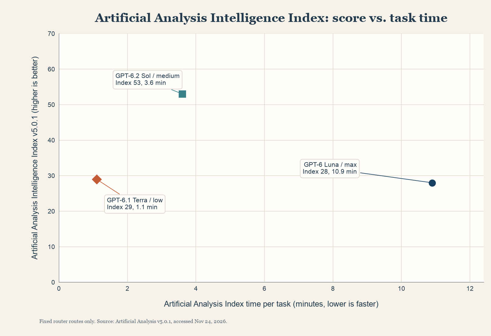
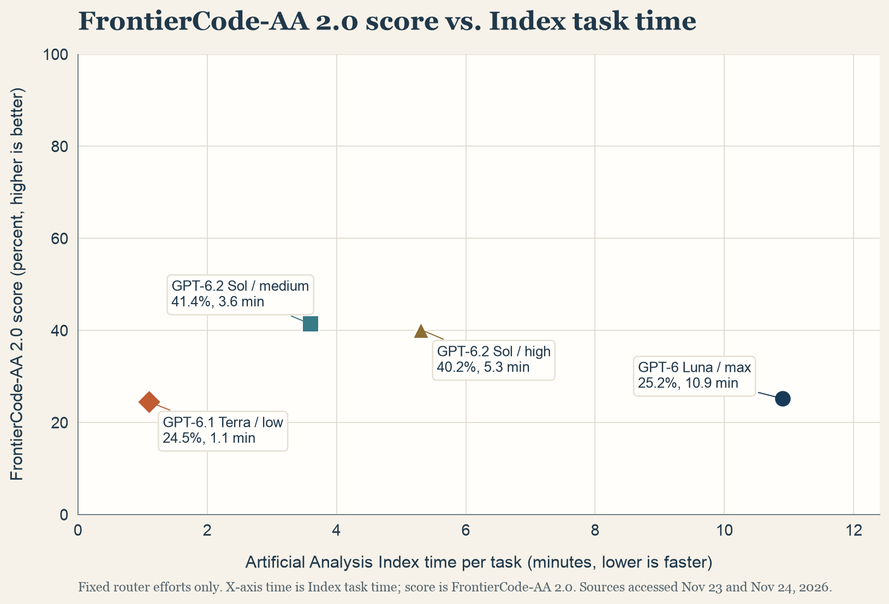

# Codex Budget Model Router

A standalone community skill for budget-aware Codex parent and subagent routing. It is not affiliated with or endorsed by OpenAI.

## Built for ChatGPT Plus Usage

Built for ChatGPT Plus at $20/month, this router aims to keep included Codex use affordable. OpenAI sets plan usage separately from API pricing, and actual use depends on the model and task ([Plus](https://help.openai.com/en/articles/6950777-what-is-chatgpt-plus), [Codex usage](https://help.openai.com/en/articles/11369540-using-codex-with-your-chatgpt-plan), [limits](https://help.openai.com/en/articles/20001625-understanding-chatgpt-and-codex-usage-limits)).

## Model and Effort Routes

| Work | Route | Why |
| --- | --- | --- |
| PARENT AGENT: Routine tasks (Easy and Medium) | GPT-6 Luna / max | Default for routine work that does not need the faster Hard route. |
| PARENT AGENT: Routine Hard tasks | GPT-6.1 Terra / low | Faster Index task time; use it for hard routine work where speed matters. |
| SUBAGENT: Routine tasks (Easy and Medium) | GPT-6 Luna / max | Same routine tiers as the parent. |
| SUBAGENT: Routine Hard tasks | GPT-6.1 Terra / low | Same faster route as the parent for hard routine work. |
| SUBAGENT: Computer Use and nonroutine Agentic tasks | GPT-6 Luna / max | Confirm the child has the required tools; routine agentic work follows the same difficulty tiers. |
| SUBAGENT: Nonroutine consequential review | GPT-6 Luna / max | Use when independent review materially improves confidence. |
| PARENT OR SUBAGENT: Complex or high-risk implementation | GPT-6.2 Sol / medium | Use for work beyond routine Hard tasks. |
| SUBAGENT: Coordination for 3+ dependent scopes | GPT-6 Luna / max | Use only when dedicated coordination materially helps. |
| PARENT OR SUBAGENT: All other models outside these routes | Explicit current-task user request only | Never select automatically. |

These model and effort choices represent the best observed performance-to-cost balance in this benchmark and usage snapshot. They keep routine work efficient and reserve higher-capability routes for tasks that benefit from them.

## Parent and Subagents

The parent is the foreman. Select its model before the task starts, using the same routine tiers as subagents. The parent owns the goal, task split, shared work, integration, verification, and acceptance. The subagent picker cannot change an already-running parent.

## Benchmark and Price Comparison

Artificial Analysis Intelligence Index v5.0.1 is a weighted composite score. Its time values are weighted averages per Index task, not Codex wall-clock time. FrontierCode-AA 2.0 is a separate agentic coding score.

| Routed model and effort | AA Intelligence Index v5.0.1 | FrontierCode-AA 2.0 | AA Index time per task | OpenAI Standard API rate per 1M input / output tokens |
| --- | ---: | ---: | ---: | ---: |
| GPT-6 Luna / max | 28 | 25.2% | 10.9 min | $0.10 / $0.50 |
| GPT-6.1 Terra / low | 29 | 24.5% | 1.1 min | $1.00 / $5.00 |
| GPT-6.2 Sol / medium | 53 | 41.4% | 3.6 min | $2.00 / $10.00 |
| GPT-6.2 Astra, effort varies by request | 46 to 62 | 45.4% at max; other efforts vary | 2.1 to 14.0 min | $8.00 / $40.00 |

OpenAI's Standard API rate for Terra is ten times Luna's per token. The supplied usage snapshot suggested about five times higher effective cost per reported token for Terra than Luna; it is not task-normalized, so the table keeps only official OpenAI Standard API rates. These rates apply to API billing, not ChatGPT Plus or Codex plan allowances. OpenAI sets plan usage separately, and actual use varies by model, task, context, reasoning, speed, and tools.

All other models outside the fixed routes require an explicit current-task request and are never selected automatically. The benchmark table includes a variable-effort comparison profile; the charts below include only the three fixed routes.

## Benchmark Graphs

Both plots use equal-sized markers and compare benchmark scores with Artificial Analysis Index time per task. The first plots the Index score; the second plots the separate FrontierCode score. OpenAI Standard API rates remain in the table, not the plots. The FrontierCode chart uses Index task time, not FrontierCode task time.

## Sources and Method

- [Artificial Analysis OpenAI comparison](https://artificialanalysis.ai/providers/openai), accessed Nov 24, 2026, for Index scores and Index task time.
- [FrontierCode-AA 2.0 filtered score view](https://artificialanalysis.ai/evaluations/frontiercode-2-0?models=gpt-6-luna%2Cgpt-6-1-terra-low%2Cgpt-6-2-sol-medium%2Cgpt-6-2-astra), accessed Nov 23, 2026, for coding scores. Artificial Analysis reports 132 tasks with three attempts per task.
- [OpenAI API model prices](https://developers.openai.com/api/docs/models) and [API pricing details](https://developers.openai.com/api/docs/pricing) for standard input and output rates.
- [Artificial Analysis chart attribution guidance](https://artificialanalysis.ai/brand-kit/) for reproducing selected scores in credited charts.

Model availability, effort settings, API rates, and ChatGPT usage limits can change. Verify current details before applying this snapshot.

## Install

Copy this repository into a folder named `codex-budget-model-router` in your Codex skills directory. Then invoke the skill by that name in Codex.

This skill contains instructions only. It has no scripts or runtime dependencies.

## License

MIT. See [LICENSE](LICENSE).
