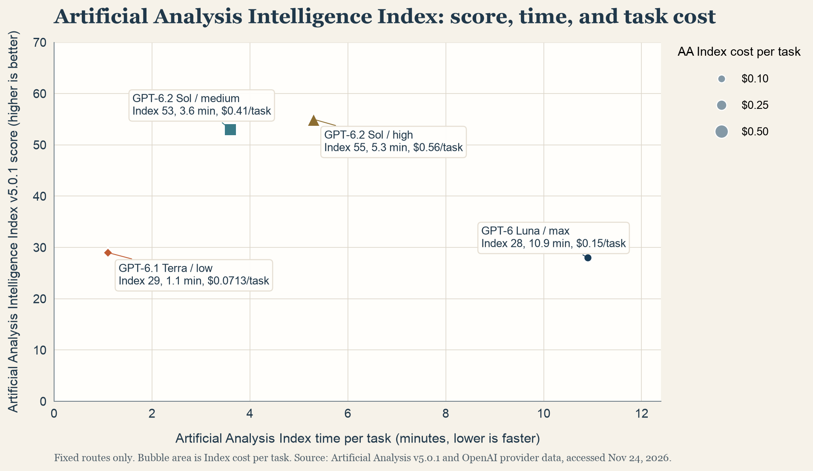
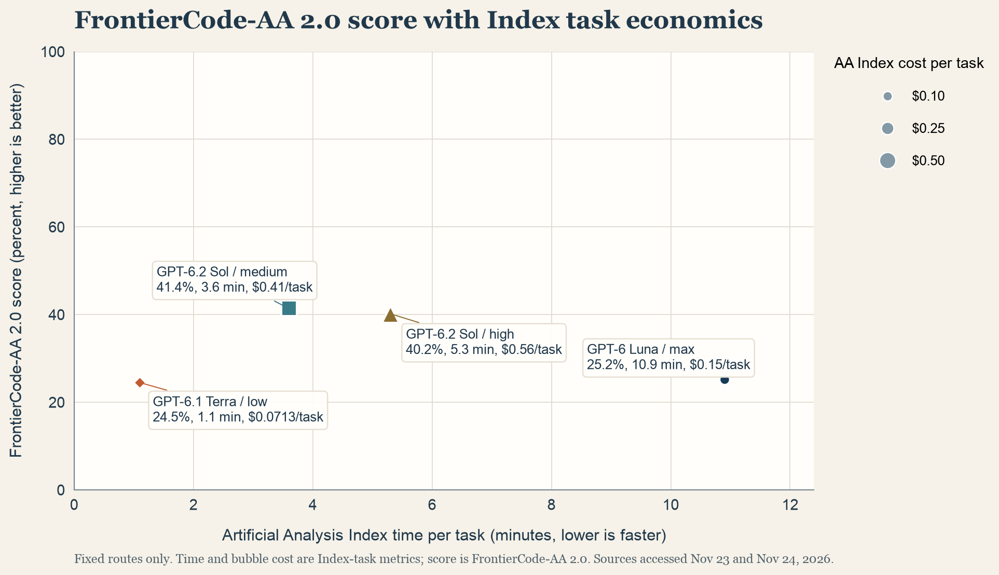

# Codex Budget Model Router

A standalone community skill for budget-aware Codex parent and subagent routing. It is not affiliated with or endorsed by OpenAI.

## Built for ChatGPT Plus Usage

Built for ChatGPT Plus at $20/month. It aims to make included Codex usage last by sending routine work to the lowest-cost capable route, then escalating when risk or results warrant it. OpenAI controls the plan allowance separately from API token billing; actual use varies with model, task, context, reasoning, speed, and tools ([Plus](https://help.openai.com/en/articles/6950777-what-is-chatgpt-plus), [Codex plan usage](https://help.openai.com/en/articles/11369540-using-codex-with-your-chatgpt-plan), [usage limits](https://help.openai.com/en/articles/20001625-understanding-chatgpt-and-codex-usage-limits)).

## Model and Effort Routes

| Work | Route | Why |
| --- | --- | --- |
| PARENT AGENT: Routine tasks (Easy to Hard) | GPT-6 Luna / max | Fixed parent route. The parent owns the task split, integration, verification, and final acceptance. |
| SUBAGENT: Routine tasks (Easy to Hard) | GPT-6.1 Terra / low | About ten times faster on Artificial Analysis Index tasks and lower estimated task cost than Luna max, despite a tenfold higher standard API rate per token. |
| SUBAGENT: Computer Use and Agentic Tasks | GPT-6 Luna / max | Use only when the child has the required tools or higher-assurance agentic work is needed. |
| SUBAGENT: Nonroutine consequential review | GPT-6 Luna / max | Use when independent review materially improves confidence. |
| SUBAGENT: Hard, complex, or high-risk implementation | GPT-6.2 Sol / medium | Use when stronger reasoning or integration is needed. |
| SUBAGENT: Ultra-complex implementation estimated under 10 minutes | GPT-6.2 Sol / high | Use medium when the estimate is 10 minutes or more, or unknown. |
| SUBAGENT: Coordination for 3+ dependent scopes | GPT-6 Luna / max | Use only when dedicated coordination materially helps. |
| SUBAGENT: Astra by current-task user request only | GPT-6.2 Astra; effort set per request | Never select automatically. |

## Parent and Subagents

The parent is the foreman. It stays on GPT-6 Luna / max and owns the goal, task split, shared work, integration, verification, and acceptance. The model picker routes subagents only; a child never changes its parent.

## Benchmark and Price Comparison

Artificial Analysis Intelligence Index v5.0.1 is a weighted composite score. Its time and cost columns are weighted averages per Index task, not Codex wall-clock time or ChatGPT plan charges. FrontierCode-AA 2.0 is a separate agentic coding score.

| Routed model and effort | AA Intelligence Index v5.0.1 | FrontierCode-AA 2.0 | AA Index time per task | AA Index cost per task | OpenAI Standard API rate per 1M input / output tokens |
| --- | ---: | ---: | ---: | ---: | ---: |
| GPT-6 Luna / max | 28 | 25.2% | 10.9 min | $0.15 | $0.10 / $0.50 |
| GPT-6.1 Terra / low | 29 | 24.5% | 1.1 min | $0.0713 | $1.00 / $5.00 |
| GPT-6.2 Sol / medium | 53 | 41.4% | 3.6 min | $0.41 | $2.00 / $10.00 |
| GPT-6.2 Sol / high | 55 | 40.2% | 5.3 min | $0.56 | $2.00 / $10.00 |
| GPT-6.2 Astra, effort varies by request | 46 to 62 | 45.4% at max; other efforts vary | 2.1 to 14.0 min | $0.66 to $4.00 | $8.00 / $40.00 |

AA Index cost is an estimate based on measured benchmark token use and API rates. OpenAI's Standard API rates for Terra are ten times Luna's per token, while the AA Index estimate is lower per completed task because token use differs. ChatGPT Plus and Codex use plan allowances, not these API list rates. OpenAI says plan usage varies with model, task, context, reasoning, speed, and tools.

Astra is selected only when the user requests it, and its effort is not fixed by this router. Its row shows the available Index range; the charts below include only the four fixed routes.

## Three-Way Graphs

Each bubble's area represents AA Index cost per task. The first chart compares Index score, Index task time, and Index task cost. The second compares FrontierCode score with the same Index task time and cost; those time and cost values are not FrontierCode-specific.

## Sources and Method

- [Artificial Analysis OpenAI comparison](https://artificialanalysis.ai/providers/openai), accessed Nov 24, 2026, for Index scores, Index task cost, and Index task time.
- [FrontierCode-AA 2.0 filtered score view](https://artificialanalysis.ai/evaluations/frontiercode-2-0?models=gpt-6-luna%2Cgpt-6-1-terra-low%2Cgpt-6-2-sol-medium%2Cgpt-6-2-sol-high%2Cgpt-6-2-astra), accessed Nov 23, 2026, for coding scores. Artificial Analysis reports 132 tasks with three attempts per task.
- [OpenAI API model prices](https://developers.openai.com/api/docs/models) and [API pricing details](https://developers.openai.com/api/docs/pricing) for standard input and output rates.
- [Artificial Analysis chart attribution guidance](https://artificialanalysis.ai/brand-kit/) for reproducing selected scores in credited charts.

Model availability, effort settings, API rates, and ChatGPT usage limits can change. Verify current details before applying this snapshot.

## Install

Copy this repository into a folder named `codex-budget-model-router` in your Codex skills directory. Then invoke the skill by that name in Codex.

This skill contains instructions only. It has no scripts or runtime dependencies.

## License

MIT. See [LICENSE](LICENSE).
